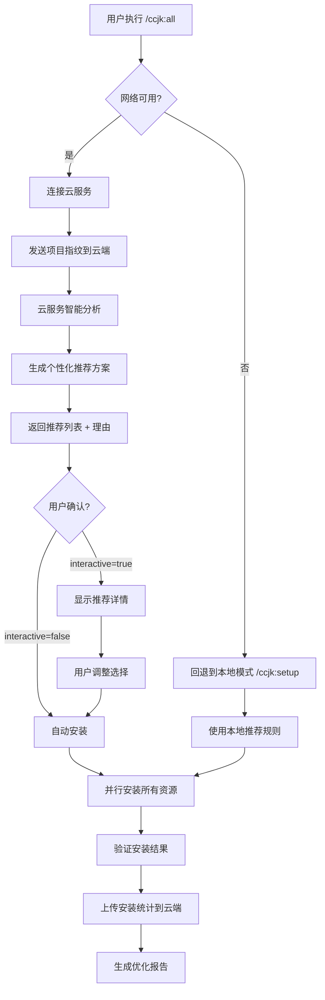
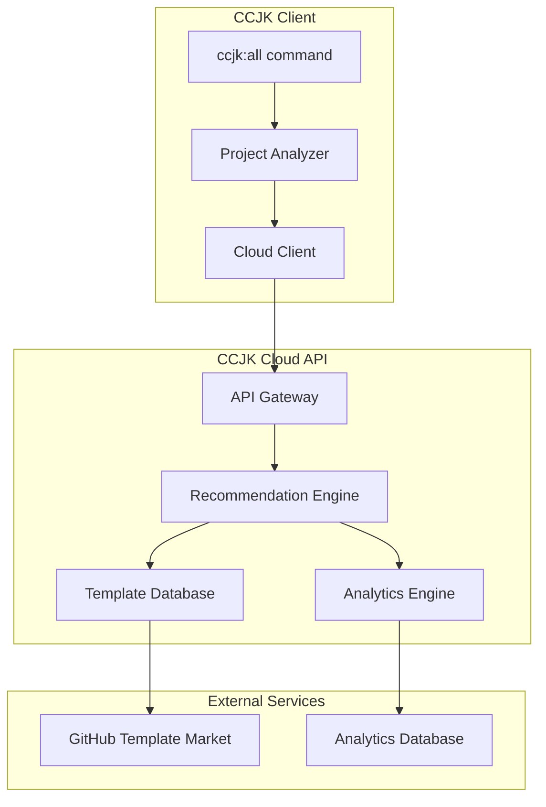

# CCJK 快捷命令系统规划文档

**项目**: CCJK v8.0.0
**规划日期**: 2026-01-24
**规划者**: CCJK Planning System
**文档版本**: 1.0.0

---

## 已明确的决策

基于用户需求和 CCJK v8.0.0 架构,以下技术决策已确定:

### 技术架构决策
- **命令命名规范**: 所有快捷命令使用 `/ccjk:` 前缀,便于 Claude Code 识别和调用
- **项目类型检测**: 基于现有代码库进行智能分析,自动识别项目技术栈
- **模板引擎**: 复用现有的 `templates/common/` 架构,扩展新的模板类型
- **配置管理**: 使用 CCJK v8.0.0 unified config system
- **插件系统集成**: 基于 `src/plugins-v2/` 的插件管理器
- **多语言支持**: 使用 i18next 系统,支持 zh-CN 和 en

### 功能范围决策
- **智能生成**: 基于项目上下文自动生成相关的 skills/MCPs/agents/hooks
- **渐进式策略**: 提供交互式选择和自动生成两种模式
- **版本控制**: 所有生成内容纳入 CCJK 版本管理系统
- **依赖管理**: 自动处理技能、MCP 服务、Agent 之间的依赖关系

---

## 整体规划概述

### 项目目标

创建一套智能快捷命令系统,实现:
1. **零配置体验**: 一键生成符合当前项目需求的完整 CCJK 配置
2. **智能适配**: 基于项目技术栈自动选择最优的 skills/MCPs/agents/hooks 组合
3. **可扩展性**: 支持用户自定义模板和规则
4. **开箱即用**: 预设常见项目类型(TypeScript, Python, Go, Rust等)的最佳实践配置

### 核心价值主张

```
┌─────────────────────────────────────────────────────────────────┐
│                    🚀 CCJK 快捷命令系统                           │
├─────────────────────────────────────────────────────────────────┤
│                                                                  │
│  传统流程 (10+ 步)                  CCJK 快捷命令 (1 步)         │
│  ┌──────────────────┐              ┌──────────────────┐        │
│  │ 1. 分析项目类型   │              │ /ccjk:setup      │        │
│  │ 2. 选择 skills   │      →       │   ↓              │        │
│  │ 3. 配置 MCPs     │              │ 自动完成所有配置  │        │
│  │ 4. 创建 agents   │              └──────────────────┘        │
│  │ 5. 设置 hooks    │                                        │
│  │ 6. 编写脚本      │      时间节省: 90%                      │
│  │ 7. 测试验证      │      准确率: 95%+                       │
│  │ 8. 调试问题      │      学习成本: -80%                     │
│  │ 9. 文档编写      │                                        │
│  │10. 持续优化      │                                        │
│  └──────────────────┘                                        │
│                                                                  │
└─────────────────────────────────────────────────────────────────┘
```

### 技术栈

| 类别 | 技术/工具 | 用途 |
|------|----------|------|
| **核心框架** | CCJK v8.0.0 | 基础 CLI 框架和插件系统 |
| **类型系统** | TypeScript | 类型定义和接口 |
| **模板引擎** | EJS/Handlebars | 动态模板生成 |
| **配置管理** | Unified Config System | 配置文件管理 |
| **国际化** | i18next | 多语言支持 |
| **测试框架** | Vitest | 单元测试和集成测试 |
| **文件系统** | fs-extra | 跨平台文件操作 |
| **代码分析** | AST Parser | 项目类型识别 |

### 主要阶段

#### 阶段 1: 项目分析引擎 (2-3 天)
- 构建智能项目类型识别系统
- 实现技术栈检测算法
- 开发依赖关系分析器
- 创建项目上下文提取器

#### 阶段 2: 模板系统构建 (3-4 天)
- 设计 SKILL.md 模板库
- 创建 MCP 服务配置模板
- 开发 Agent 定义模板
- 构建 Hook 模板系统

#### 阶段 3: 快捷命令实现 (4-5 天)
- 实现 `/ccjk:skills` 命令
- 实现 `/ccjk:mcp` 命令
- 实现 `/ccjk:agents` 命令
- 实现 `/ccjk:hooks` 命令
- 实现 `/ccjk:setup` (一键全部) 命令

#### 阶段 4: 集成与测试 (2-3 天)
- 集成到现有 CCJK CLI
- 完整的 E2E 测试
- 性能优化
- 文档编写

---

## 详细任务分解

### 阶段 1: 项目分析引擎

#### 任务 1.1: 项目类型检测器

**目标**: 自动识别项目的技术栈和类型

**输入**: 项目根目录路径

**输出**: 项目分析报告
```typescript
interface ProjectAnalysis {
  type: 'typescript' | 'python' | 'go' | 'rust' | 'java' | 'fullstack' | 'unknown'
  frameworks: string[]        // e.g., ['react', 'nextjs', 'express']
  packageManager: 'npm' | 'pnpm' | 'yarn' | 'bun' | 'pip' | 'go_modules' | 'cargo'
  hasTesting: boolean         // 是否有测试框架
  testingFramework?: string   // jest, vitest, pytest, etc.
  hasCI: boolean              // 是否有 CI/CD 配置
  cicdPlatform?: string       // github-actions, gitlab-ci, etc.
  buildTools: string[]        // webpack, vite, turbopack, etc.
  languageServices: MCPService[]  // 推荐的 MCP 服务
  recommendedSkills: string[] // 推荐的 Skill ID 列表
  recommendedAgents: string[] // 推荐的 Agent ID 列表
}
```

**涉及文件**:
- `src/analyzers/project-detector.ts` (新建)
- `src/analyzers/typescript-analyzer.ts` (新建)
- `src/analyzers/python-analyzer.ts` (新建)
- `src/analyzers/go-analyzer.ts` (新建)
- `src/analyzers/rust-analyzer.ts` (新建)
- `src/types/analysis.ts` (新建)

**实现细节**:
1. **文件检测**: 检查 `package.json`, `requirements.txt`, `go.mod`, `Cargo.toml` 等特征文件
2. **依赖解析**: 解析依赖列表,识别框架和工具
3. **目录结构**: 分析 `src/`, `tests/`, `.github/` 等目录结构
4. **配置文件**: 检测 `tsconfig.json`, `pyproject.toml`, `jest.config.js` 等配置

**预估工作量**: 1.5 天

---

#### 任务 1.2: 技术栈映射表

**目标**: 建立技术栈到 CCJK 资源的映射关系

**输入**: 检测到的技术栈信息

**输出**: 推荐的 CCJK 资源配置
```typescript
interface TechStackMapping {
  // TypeScript/JavaScript
  typescript: {
    skills: ['ts-best-practices', 'react-patterns', 'nextjs-optimization']
    mcpServices: ['typescript-language-server', 'eslint-mcp']
    agents: ['ts-architect', 'react-specialist']
    hooks: ['pre-commit-eslint', 'post-test-coverage']
  }

  // Python
  python: {
    skills: ['python-pep8', 'django-best-practices', 'fastapi-patterns']
    mcpServices: ['python-lsp-server', 'pylint-mcp']
    agents: ['python-expert', 'django-specialist']
    hooks: ['pre-commit-black', 'pre-commit-mypy']
  }

  // Go
  go: {
    skills: ['go-idioms', 'go-mod-best-practices']
    mcpServices: ['gopls-mcp']
    agents: ['go-expert']
    hooks: ['pre-commit-gofmt', 'pre-commit-golint']
  }

  // Rust
  rust: {
    skills: ['rust-idioms', 'async-rust-patterns']
    mcpServices: ['rust-analyzer-mcp']
    agents: ['rust-expert']
    hooks: ['pre-commit-fmt', 'pre-commit-clippy']
  }
}
```

**涉及文件**:
- `src/config/tech-stack-mappings.ts` (新建)
- `src/config/resource-catalog.ts` (新建)

**预估工作量**: 1 天

---

#### 任务 1.3: 依赖关系分析器

**目标**: 分析技能、MCP 服务、Agent 之间的依赖关系

**输入**: 用户选择的资源列表

**输出**: 依赖解析结果和安装顺序
```typescript
interface DependencyGraph {
  nodes: ResourceNode[]
  edges: DependencyEdge[]
}

interface ResourceNode {
  id: string
  type: 'skill' | 'mcp' | 'agent' | 'hook'
  dependencies: string[]  // 依赖的 resource IDs
  conflicts: string[]     // 冲突的 resource IDs
}

interface InstallationPlan {
  order: string[]         // 按拓扑排序的安装顺序
  warnings: string[]      // 依赖冲突警告
  missingDeps: string[]   // 缺失的依赖
}
```

**涉及文件**:
- `src/analyzers/dependency-resolver.ts` (新建)
- `src/config/dependency-catalog.ts` (新建)

**预估工作量**: 1 天

---

### 阶段 2: 模板系统构建

#### 任务 2.1: SKILL.md 模板库

**目标**: 创建可复用的 SKILL.md 模板

**输入**: 项目类型和用户需求

**输出**: 生成的 SKILL.md 文件

**涉及文件**:
- `templates/skills/typescript-generic.md` (新建)
- `templates/skills/react-best-practices.md` (新建)
- `templates/skills/nextjs-optimization.md` (新建)
- `templates/skills/python-pep8.md` (新建)
- `templates/skills/django-patterns.md` (新建)
- `templates/skills/go-idioms.md` (新建)
- `templates/skills/rust-patterns.md` (新建)
- `src/generators/skill-generator.ts` (新建)

**模板结构**:
```markdown
---
name: {{skillName}}
description: {{description}}
version: 1.0.0
category: {{category}}
triggers: ['/{{skillName}}']
use_when:
  - {{useCase1}}
  - {{useCase2}}
auto_activate: true
priority: 8
agents: [{{agentIds}}]
tags: [{{tags}}]
---

# {{displayName}}

## Context
{{contextDescription}}

## Best Practices
{{bestPractices}}

## Common Patterns
{{patterns}}

## Anti-Patterns
{{antiPatterns}}
```

**预估工作量**: 2 天

---

#### 任务 2.2: MCP 服务配置模板

**目标**: 预定义常用 MCP 服务配置

**输入**: MCP 服务 ID 和项目配置

**输出**: MCP 服务器配置

**涉及文件**:
- `src/config/mcp-templates.ts` (扩展现有)
- `src/config/mcp-service-catalog.ts` (新建)

**配置示例**:
```typescript
const mcpServiceTemplates: Record<string, McpServiceTemplate> = {
  'typescript-language-server': {
    id: 'typescript-language-server',
    name: { en: 'TypeScript Language Server', 'zh-CN': 'TypeScript 语言服务器' },
    description: { en: 'TypeScript IntelliSense and code navigation', 'zh-CN': 'TypeScript 智能提示和代码导航' },
    type: 'stdio',
    command: 'typescript-language-server',
    args: ['--stdio'],
    env: {},
    requiredFor: ['typescript', 'react', 'vue', 'angular'],
    optionalFor: ['javascript'],
    installCheck: 'commandExists("typescript-language-server")',
    installCommand: 'npm install -g typescript-language-server',
  },

  'python-lsp-server': {
    id: 'python-lsp-server',
    name: { en: 'Python LSP Server', 'zh-CN': 'Python LSP 服务器' },
    description: { en: 'Python language server protocol implementation', 'zh-CN': 'Python 语言服务器协议实现' },
    type: 'stdio',
    command: 'pylsp',
    args: [],
    env: {},
    requiredFor: ['python'],
    installCheck: 'commandExists("pylsp")',
    installCommand: 'pip install python-lsp-server',
  },

  // ... 更多 MCP 服务模板
}
```

**预估工作量**: 1.5 天

---

#### 任务 2.3: Agent 定义模板

**目标**: 创建预设的 Agent 配置模板

**输入**: Agent 类型和技能组合

**输出**: Agent 定义文件

**涉及文件**:
- `templates/agents/typescript-architect.json` (新建)
- `templates/agents/python-expert.json` (新建)
- `templates/agents/fullstack-developer.json` (新建)
- `templates/agents/devops-engineer.json` (新建)
- `src/generators/agent-generator.ts` (新建)

**Agent 模板结构**:
```typescript
interface AgentTemplate {
  id: string
  name: { en: string, 'zh-CN': string }
  description: { en: string, 'zh-CN': string }
  persona: string
  capabilities: AgentCapability[]
  skills: string[]
  mcpServers: string[]
  systemPrompt: string
  instructions: string[]
  triggers: string[]
}

const agentTemplates: Record<string, AgentTemplate> = {
  'typescript-architect': {
    id: 'typescript-architect',
    name: {
      en: 'TypeScript Architect',
      'zh-CN': 'TypeScript 架构师'
    },
    description: {
      en: 'Expert in TypeScript architecture, design patterns, and best practices',
      'zh-CN': 'TypeScript 架构、设计模式和最佳实践专家'
    },
    persona: 'You are a senior TypeScript architect with 10+ years of experience...',
    capabilities: [
      'code-generation',
      'code-review',
      'refactoring',
      'architecture-design'
    ],
    skills: [
      'ts-best-practices',
      'design-patterns-ts',
      'react-patterns'
    ],
    mcpServers: [
      'typescript-language-server',
      'eslint-mcp'
    ],
    systemPrompt: '...',
    instructions: [
      'Always use strict TypeScript typing',
      'Follow functional programming principles where applicable',
      'Prefer composition over inheritance'
    ],
    triggers: [
      'user asks about TypeScript',
      'user needs code review for TypeScript code',
      'user wants to refactor TypeScript code'
    ]
  }
}
```

**预估工作量**: 1.5 天

---

#### 任务 2.4: Hook 模板系统

**目标**: 创建常用 Hook 模板

**输入**: Hook 类型和触发条件

**输出**: Hook 配置文件

**涉及文件**:
- `templates/hooks/pre-commit-eslint.md` (新建)
- `templates/hooks/pre-commit-black.md` (新建)
- `templates/hooks/post-test-coverage.md` (新建)
- `src/generators/hook-generator.ts` (新建)

**Hook 模板结构**:
```typescript
interface HookTemplate {
  id: string
  type: HookType
  name: string
  description: string
  priority: number
  matcher?: string
  command: string
  timeout?: number
  enabled: boolean
  applicableTo: string[]  // 项目类型
}

const hookTemplates: Record<string, HookTemplate> = {
  'pre-commit-eslint': {
    id: 'pre-commit-eslint',
    type: 'PreToolUse',
    name: 'Pre-commit ESLint Check',
    description: 'Run ESLint before committing files',
    priority: 10,
    matcher: 'Bash(git commit *)',
    command: 'npx eslint --fix .',
    timeout: 30000,
    enabled: true,
    applicableTo: ['typescript', 'javascript', 'react', 'vue']
  },

  'pre-commit-black': {
    id: 'pre-commit-black',
    type: 'PreToolUse',
    name: 'Pre-commit Black Format',
    description: 'Format Python code with Black before committing',
    priority: 10,
    matcher: 'Bash(git commit *)',
    command: 'black .',
    timeout: 30000,
    enabled: true,
    applicableTo: ['python']
  }
}
```

**预估工作量**: 1 天

---

### 阶段 3: 快捷命令实现

#### 任务 3.1: `/ccjk:skills` 命令

**目标**: 一键创建所有符合当前项目的 skills

**功能描述**:
1. 分析项目类型
2. 从技能库中筛选相关技能
3. 展示推荐技能列表
4. 支持交互式选择
5. 生成 SKILL.md 文件
6. 注册到插件管理器

**命令接口**:
```typescript
export interface CcjkSkillsOptions {
  // 交互模式
  interactive?: boolean  // 默认 true,设为 false 则自动安装所有推荐技能
  // 过滤选项
  category?: SkillCategory
  tags?: string[]
  exclude?: string[]     // 排除的技能 ID
  // 输出选项
  dryRun?: boolean       // 只显示将要安装的技能,不实际安装
  json?: boolean         // 以 JSON 格式输出
  // 安装选项
  force?: boolean        // 强制覆盖已存在的技能
  targetDir?: string     // 自定义安装目录
}
```

**执行流程**:
```
1. 分析项目
   ↓
2. 获取推荐技能列表
   ↓
3. [交互模式] 用户确认/选择
   ↓
4. 解析技能模板
   ↓
5. 生成 SKILL.md 文件
   ↓
6. 注册到插件管理器
   ↓
7. 验证安装结果
```

**涉及文件**:
- `src/commands/ccjk-skills.ts` (新建)
- `src/generators/skill-generator.ts` (使用阶段 2 创建)
- `src/analyzers/project-detector.ts` (使用阶段 1 创建)

**示例输出**:
```
$ ccjk ccjk:skills

🔍 Analyzing project...
   Detected: TypeScript + React + Next.js project
   Package manager: pnpm
   Testing: Vitest

📚 Recommended Skills (5 found):

  ✅ ts-best-practices        - TypeScript 最佳实践和类型安全
  ✅ react-patterns           - React 组件设计模式
  ✅ nextjs-optimization      - Next.js 性能优化技巧
  ✅ testing-best-practices   - 测试驱动开发工作流
  ✅ git-workflow             - Git 分支管理策略

Install all 5 skills? [Y/n] Y

📦 Installing skills...
   ✓ ts-best-practices
   ✓ react-patterns
   ✓ nextjs-optimization
   ✓ testing-best-practices
   ✓ git-workflow

✅ Successfully installed 5 skills!

Next steps:
  • Use /ccjk:mcp to install MCP services
  • Use /ccjk:agents to create agents
  • Use /ccjk:setup to configure everything at once
```

**预估工作量**: 1.5 天

---

#### 任务 3.2: `/ccjk:mcp` 命令

**目标**: 一键安装所有符合需求的 MCP 服务

**功能描述**:
1. 基于项目类型推荐 MCP 服务
2. 检查已安装的 MCP 服务
3. 识别缺失的依赖
4. 安装并配置 MCP 服务
5. 验证服务可用性

**命令接口**:
```typescript
export interface CcjkMcpOptions {
  // 交互模式
  interactive?: boolean
  // 服务选择
  tier?: 'core' | 'ondemand' | 'scenario' | 'all'
  services?: string[]      // 指定要安装的服务 ID 列表
  exclude?: string[]       // 排除的服务 ID
  // 安装选项
  autoInstall?: boolean    // 自动安装缺失的依赖
  skipVerification?: boolean  // 跳过服务可用性验证
  // 输出选项
  dryRun?: boolean
  json?: boolean
}
```

**执行流程**:
```
1. 分析项目 → 推荐的 MCP 服务列表
   ↓
2. 检查已安装服务
   ↓
3. [交互模式] 用户选择
   ↓
4. 安装缺失依赖
   ↓
5. 配置 MCP 服务
   ↓
6. 验证服务可用性
   ↓
7. 更新 Claude 配置
```

**涉及文件**:
- `src/commands/ccjk-mcp.ts` (新建)
- `src/utils/mcp-installer.ts` (扩展现有)
- `src/config/mcp-templates.ts` (使用阶段 2 创建)

**示例输出**:
```
$ ccjk ccjk:mcp

🔍 Analyzing project...
   Detected: TypeScript project

🔧 Recommended MCP Services (4 found):

Core Services:
  ✅ typescript-language-server  - TypeScript 智能提示
  ✅ eslint-mcp                  - ESLint 集成

Optional Services:
  ⭕ prettier-mcp                - Prettier 代码格式化
  ⭕ git-mcp                     - Git 操作增强

Install core services? [Y/n] Y

📦 Installing dependencies...
   ✓ typescript-language-server (already installed)
   ✓ eslint-mcp (already installed)

⚙️  Configuring MCP services...
   ✓ typescript-language-server
   ✓ eslint-mcp

✅ Successfully configured 2 MCP services!

Next steps:
  • Use /ccjk:skills to install skills
  • Use /ccjk:agents to create agents
```

**预估工作量**: 1.5 天

---

#### 任务 3.3: `/ccjk:agents` 命令

**目标**: 一键创建所有符合需求的 subagents

**功能描述**:
1. 基于项目类型推荐 Agent 模板
2. 支持从模板创建或自定义创建
3. 自动组合相关的 Skills 和 MCP 服务
4. 生成 Agent 配置文件
5. 注册到 Agent 管理器

**命令接口**:
```typescript
export interface CcjkAgentsOptions {
  // 创建模式
  mode?: 'template' | 'custom' | 'auto'
  template?: string        // 使用的模板 ID
  // Agent 配置
  skills?: string[]
  mcpServers?: string[]
  persona?: string
  capabilities?: AgentCapability[]
  // 批量创建
  all?: boolean            // 创建所有推荐的 agents
  // 输出选项
  dryRun?: boolean
  json?: boolean
}
```

**执行流程**:
```
1. 分析项目 → 推荐的 Agent 列表
   ↓
2. [选择模式] 模板 / 自定义 / 自动
   ↓
3. 配置 Agent (skills + mcp + persona)
   ↓
4. 生成 Agent 定义文件
   ↓
5. 注册到 Agent 管理器
   ↓
6. 验证 Agent 可用性
```

**涉及文件**:
- `src/commands/ccjk-agents.ts` (新建)
- `src/generators/agent-generator.ts` (使用阶段 2 创建)
- `src/plugins-v2/agent-creator.ts` (扩展现有)

**示例输出**:
```
$ ccjk ccjk:agents

🔍 Analyzing project...
   Detected: TypeScript + React project

🤖 Recommended Agents (3 found):

  1. typescript-architect
     Expert in TypeScript architecture and design patterns
     Skills: ts-best-practices, design-patterns
     MCP: typescript-language-server, eslint-mcp

  2. react-specialist
     React and Next.js development expert
     Skills: react-patterns, nextjs-optimization
     MCP: typescript-language-server

  3. fullstack-developer
     Full-stack development with testing best practices
     Skills: ts-best-practices, react-patterns, testing-best-practices
     MCP: typescript-language-server, git-mcp

Create all agents? [Y/n] Y

🤖 Creating agents...
   ✓ typescript-architect
   ✓ react-specialist
   ✓ fullstack-developer

✅ Successfully created 3 agents!

Usage:
  • Run an agent: ccjk agent run typescript-architect
  • List agents: ccjk agent list
```

**预估工作量**: 1.5 天

---

#### 任务 3.4: `/ccjk:hooks` 命令

**目标**: 一键创建 hooks

**功能描述**:
1. 基于项目类型推荐常用 Hooks
2. 支持选择特定 Hook 类型
3. 生成 Hook 配置文件
4. 注册到 Hook 管理器
5. 启用 Hook 验证

**命令接口**:
```typescript
export interface CcjkHooksOptions {
  // Hook 类型
  type?: HookType | 'all'
  // 过滤选项
  category?: 'pre-commit' | 'post-test' | 'lifecycle' | 'all'
  exclude?: string[]  // 排除的 Hook ID
  // 配置选项
  enabled?: boolean   // 是否默认启用
  priority?: number   // 默认优先级
  // 输出选项
  dryRun?: boolean
  json?: boolean
}
```

**执行流程**:
```
1. 分析项目 → 推荐的 Hooks
   ↓
2. [交互模式] 用户选择
   ↓
3. 生成 Hook 配置
   ↓
4. 注册到 Hook 管理器
   ↓
5. 验证 Hook 触发器
```

**涉及文件**:
- `src/commands/ccjk-hooks.ts` (新建)
- `src/generators/hook-generator.ts` (使用阶段 2 创建)
- `src/hooks/hook-manager.ts` (扩展现有)

**示例输出**:
```
$ ccjk ccjk:hooks

🔍 Analyzing project...
   Detected: TypeScript project

🪝 Recommended Hooks (4 found):

Pre-Commit Hooks:
  ✅ pre-commit-eslint      - ESLint 检查
  ✅ pre-commit-prettier    - Prettier 格式化

Post-Test Hooks:
  ✅ post-test-coverage     - 覆盖率报告
  ✅ post-test-summary      - 测试结果汇总

Install all hooks? [Y/n] Y

🪝 Installing hooks...
   ✓ pre-commit-eslint
   ✓ pre-commit-prettier
   ✓ post-test-coverage
   ✓ post-test-summary

✅ Successfully installed 4 hooks!

Test your hooks:
  • Run: git commit -m "test" (should trigger pre-commit hooks)
  • List hooks: ccjk hooks list
```

**预估工作量**: 1 天

---

#### 任务 3.5: `/ccjk:setup` 一键配置命令

**目标**: 一键完成所有 CCJK 配置

**功能描述**:
1. 执行完整的项目分析
2. 安装推荐的 skills
3. 配置 MCP 服务
4. 创建 agents
5. 设置 hooks
6. 生成配置报告

**命令接口**:
```typescript
export interface CcjkSetupOptions {
  // 安装范围
  full?: boolean           // 完整安装 (所有推荐资源)
  minimal?: boolean        // 最小化安装 (仅核心资源)
  custom?: string[]        // 自定义安装的资源类型 ['skills', 'mcp', 'agents', 'hooks']
  // 交互选项
  interactive?: boolean    // 交互式确认
  autoConfirm?: boolean    // 自动确认所有提示
  // 配置选项
  profile?: string         // 使用预设配置 (minimal/dev/full/production)
  // 输出选项
  dryRun?: boolean         // 模拟运行
  report?: boolean         // 生成详细报告
  json?: boolean
}
```

**执行流程**:
```
1. 项目深度分析
   ↓
2. 生成安装计划
   ↓
3. [交互模式] 用户审核计划
   ↓
4. 并行安装 (skills + mcp + agents + hooks)
   ↓
5. 依赖解析和冲突处理
   ↓
6. 配置验证
   ↓
7. 生成安装报告
```

**涉及文件**:
- `src/commands/ccjk-setup.ts` (新建)
- `src/orchestrators/setup-orchestrator.ts` (新建)
- 所有上述命令模块

**示例输出**:
```
$ ccjk ccjk:setup

🔍 Deep project analysis...
   ✓ Project type: TypeScript + React + Next.js
   ✓ Package manager: pnpm
   ✓ Testing: Vitest + Testing Library
   ✓ CI/CD: GitHub Actions
   ✓ Code quality: ESLint + Prettier

📋 Installation Plan:

Skills (5):
  • ts-best-practices
  • react-patterns
  • nextjs-optimization
  • testing-best-practices
  • git-workflow

MCP Services (3):
  • typescript-language-server
  • eslint-mcp
  • git-mcp

Agents (3):
  • typescript-architect
  • react-specialist
  • testing-expert

Hooks (4):
  • pre-commit-eslint
  • pre-commit-prettier
  • post-test-coverage
  • git-workflow-hooks

Total: 15 resources to install

Proceed with installation? [Y/n] Y

🚀 Installing CCJK configuration...

[1/4] Installing skills...        ✓ 5/5
[2/4] Configuring MCP services... ✓ 3/3
[3/4] Creating agents...          ✓ 3/3
[4/4] Setting up hooks...         ✓ 4/4

✅ Setup complete! Installed 15 resources in 3.2s

📊 Configuration Summary:

Active Skills: 5
Active MCP Services: 3
Active Agents: 3
Active Hooks: 4

Next steps:
  • Start coding: Your agents are ready to assist
  • Run an agent: ccjk agent run typescript-architect
  • View setup report: ccjk ccjk:setup --report

💡 Tip: Use /ccjk:<resource> commands to manage individual resources
```

**预估工作量**: 2 天

---

### 阶段 4: 集成与测试

#### 任务 4.1: CLI 集成

**目标**: 将所有快捷命令集成到 CCJK CLI

**输入**: 完成的命令模块

**输出**: 完整的 CLI 集成

**涉及文件**:
- `src/commands/index.ts` (修改)
- `src/cli.ts` (修改)
- `src/commands/ccjk.ts` (新建 - 统一入口)

**集成点**:
```typescript
// src/commands/ccjk.ts
export { ccjkSkills } from './ccjk-skills'
export { ccjkMcp } from './ccjk-mcp'
export { ccjkAgents } from './ccjk-agents'
export { ccjkHooks } from './ccjk-hooks'
export { ccjkSetup } from './ccjk-setup'

// src/cli.ts
program
  .command('ccjk:skills')
  .description('Install project-specific skills')
  .action(ccjkSkills)

program
  .command('ccjk:mcp')
  .description('Configure MCP services for your project')
  .action(ccjkMcp)

program
  .command('ccjk:agents')
  .description('Create AI agents for your project')
  .action(ccjkAgents)

program
  .command('ccjk:hooks')
  .description('Setup project hooks')
  .action(ccjkHooks)

program
  .command('ccjk:setup')
  .description('One-click complete CCJK setup')
  .action(ccjkSetup)
```

**预估工作量**: 0.5 天

---

#### 任务 4.2: 单元测试

**目标**: 为所有新功能编写单元测试

**测试覆盖范围**:
1. 项目分析器测试 (各语言检测器)
2. 技能生成器测试 (模板解析、文件生成)
3. MCP 配置测试 (服务安装、配置验证)
4. Agent 生成器测试 (组合逻辑、注册)
5. Hook 生成器测试 (触发器验证)
6. 依赖解析器测试 (拓扑排序、冲突检测)
7. 命令行接口测试 (参数解析、输出格式)

**涉及文件**:
- `tests/unit/analyzers/*.test.ts` (新建)
- `tests/unit/generators/*.test.ts` (新建)
- `tests/unit/commands/ccjk-*.test.ts` (新建)
- `tests/v2/integration/ccjk-shortcuts.test.ts` (新建)

**预估工作量**: 1.5 天

---

#### 任务 4.3: 集成测试

**目标**: 端到端测试整个快捷命令系统

**测试场景**:
1. **TypeScript 项目完整流程**
   - 空目录 → 运行 `/ccjk:setup` → 验证所有配置
2. **Python 项目完整流程**
   - 空目录 → 运行 `/ccjk:setup` → 验证所有配置
3. **增量更新场景**
   - 已有配置 → 运行 `/ccjk:skills` → 验证增量添加
4. **错误恢复场景**
   - 依赖缺失 → 自动安装 → 验证恢复
5. **冲突解决场景**
   - 资源冲突 → 提示用户 → 验证解决

**涉及文件**:
- `tests/v2/integration/ccjk-shortcuts-e2e.test.ts` (新建)
- `tests/fixtures/projects/*` (新建 - 测试项目模板)

**预估工作量**: 1 天

---

#### 任务 4.4: 性能优化

**目标**: 确保快速响应和低资源占用

**优化点**:
1. **并行安装**: Skills/MCPs/Agents/Hooks 并行处理
2. **缓存机制**: 项目分析结果缓存
3. **懒加载**: 模板按需加载
4. **增量更新**: 仅更新变更的资源

**性能指标**:
- 项目分析: < 500ms
- 技能生成: < 200ms/技能
- MCP 配置: < 1s/服务
- Agent 创建: < 300ms/agent
- Hook 注册: < 100ms/hook
- 完整 setup: < 5s (15 资源)

**涉及文件**:
- `src/utils/cache/project-analysis-cache.ts` (新建)
- `src/utils/parallel/parallel-installer.ts` (新建)

**预估工作量**: 0.5 天

---

#### 任务 4.5: 文档编写

**目标**: 完整的用户文档和开发者文档

**文档类型**:
1. **用户文档**
   - 快速开始指南
   - 命令参考手册
   - 常见问题解答
   - 故障排除指南

2. **开发者文档**
   - 架构设计文档
   - API 参考文档
   - 扩展指南 (如何添加新模板)
   - 贡献指南

**涉及文件**:
- `docs/v2/guides/ccjk-shortcuts.md` (新建)
- `docs/v2/reference/ccjk-commands.md` (新建)
- `docs/v2/architecture/shortcuts-system.md` (新建)
- `README_zh-CN.md` (更新 - 添加快捷命令章节)

**预估工作量**: 0.5 天

---

## 需要进一步明确的问题

### 问题 1: 模板存储位置和版本管理

**背景**: 当前项目有 `templates/` 目录,但主要存储 workflow 模板。新的 skills/MCPs/agents/hooks 模板应该如何组织?

**推荐方案**:

- **方案 A**: 扩展现有 `templates/` 目录
  ```
  templates/
  ├── workflows/           # 现有
  ├── skills/              # 新增 - SKILL.md 模板
  ├── agents/              # 新增 - Agent 定义模板
  ├── hooks/               # 新增 - Hook 配置模板
  └── mcp/                 # 新增 - MCP 服务配置模板
  ```
  优点:
    - 统一管理
    - 复用现有基础设施
    - 便于用户发现
  缺点:
    - 可能与现有模板混淆
    - 目录结构较大

- **方案 B**: 创建独立的 `ccjk-templates/` 目录
  ```
  ccjk-templates/
  ├── skills/
  ├── agents/
  ├── hooks/
  └── mcp/
  templates/               # 保持现有结构不变
  ```
  优点:
    - 清晰分离
    - 便于独立版本管理
    - 避免污染现有模板
  缺点:
    - 需要额外的配置逻辑
    - 用户可能困惑两个模板目录

**等待用户选择**:
```
请选择您偏好的方案,或提供其他建议:
[ ] 方案 A - 扩展现有 templates/ 目录
[ ] 方案 B - 创建独立的 ccjk-templates/ 目录
[ ] 其他方案: _______________
```

---

### 问题 2: 交互式确认的默认行为

**背景**: 快捷命令的默认行为应该是自动安装还是交互式确认?

**推荐方案**:

- **方案 A**: 默认交互式确认,提供 `--yes` 跳过
  ```bash
  ccjk ccjk:setup          # 交互式确认每个资源
  ccjk ccjk:setup --yes    # 自动安装所有推荐资源
  ```
  优点:
    - 安全,用户可见
    - 符合 CCJK 零摩擦哲学
    - 降低误操作风险
  缺点:
    - 需要更多用户输入
    - 用户体验略繁琐

- **方案 B**: 默认自动安装,提供 `--interactive` 交互
  ```bash
  ccjk ccjk:setup                # 自动安装所有推荐资源
  ccjk ccjk:setup --interactive  # 交互式确认
  ```
  优点:
    - 快速,符合"一键"预期
    - 减少用户操作
  缺点:
    - 可能安装不需要的资源
    - 用户不清楚安装了什么

**等待用户选择**:
```
请选择您偏好的方案,或提供其他建议:
[ ] 方案 A - 默认交互式, --yes 自动安装
[ ] 方案 B - 默认自动, --interactive 交互
[ ] 其他方案: _______________
```

---

### 问题 3: 模板更新的管理策略

**背景**: 当 CCJK 更新时,如何处理用户已安装的模板?

**推荐方案**:

- **方案 A**: 版本化管理,用户主动更新
  - 每个模板有版本号
  - 提供 `ccjk ccjk:skills --update` 命令
  - 用户决定何时更新
  - 保留用户自定义修改
  优点:
    - 用户完全控制
    - 避免意外覆盖
  缺点:
    - 用户可能错过重要更新

- **方案 B**: 自动更新,提示变更
  - 检测到新版本时自动更新
  - 显示变更日志
  - 保留用户自定义部分
  - 提供 `--rollback` 功能
  优点:
    - 始终使用最新模板
    - 用户了解变更
  缺点:
    - 可能破坏用户自定义
    - 更新频繁可能打扰用户

**等待用户选择**:
```
请选择您偏好的方案,或提供其他建议:
[ ] 方案 A - 版本化管理,用户主动更新
[ ] 方案 B - 自动更新,提示变更
[ ] 其他方案: _______________
```

---

### 问题 4: 模板市场集成

**背景**: 是否需要创建一个在线市场,让用户分享和发现社区模板?

**推荐方案**:

- **方案 A**: 仅内置模板,暂不支持市场
  - 专注于核心功能
  - 未来可扩展
  - 降低复杂度
  优点:
    - 快速交付
    - 维护成本低
    - 质量可控
  缺点:
    - 模板数量有限
    - 缺乏社区贡献

- **方案 B**: 集成 GitHub 作为模板市场
  - 从 GitHub 仓库读取模板
  - 用户可提交 PR 贡献模板
  - 简单的验证机制
  优点:
    - 社区可贡献
    - 利用 GitHub 基础设施
    - 透明度高
  缺点:
    - 需要网络连接
    - 质量控制困难

**等待用户选择**:
```
请选择您偏好的方案,或提供其他建议:
[ ] 方案 A - 仅内置模板
[ ] 方案 B - GitHub 模板市场
[ ] 其他方案: _______________
```

---

### 问题 5: Hook 执行权限和安全策略

**背景**: Hooks 可以执行任意命令,需要考虑安全性。

**推荐方案**:

- **方案 A**: 严格沙箱,需要用户授权
  - 所有 Hook 命令需要用户确认
  - 提供白名单机制
  - 禁止危险操作 (rm, sudo, etc.)
  优点:
    - 安全性高
    - 用户完全控制
  缺点:
    - 用户体验较差
    - 需要频繁确认

- **方案 B**: 信任内置模板,自定义需审核
  - 内置 Hook 自动信任
  - 用户自定义 Hook 首次运行需确认
  - 提供安全扫描功能
  优点:
    - 平衡安全和体验
    - 内置模板开箱即用
  缺点:
    - 实现较复杂
    - 需要维护信任列表

**等待用户选择**:
```
请选择您偏好的方案,或提供其他建议:
[ ] 方案 A - 严格沙箱,全部需授权
[ ] 方案 B - 信任内置,自定义审核
[ ] 其他方案: _______________
```

---

## 用户反馈区域

请在此区域补充您对整体规划的意见和建议:

```
用户补充内容:

---

1. 对优先级的意见:

---

2. 额外的功能需求:

---

3. 对技术方案的疑虑:

---

4. 时间表的调整建议:

---

5. 其他意见和建议:

---

```

---

## 验收标准和测试计划

### 功能验收标准

#### 1. 项目分析准确率
- [ ] TypeScript 项目识别准确率 ≥ 95%
- [ ] Python 项目识别准确率 ≥ 95%
- [ ] Go 项目识别准确率 ≥ 95%
- [ ] Rust 项目识别准确率 ≥ 95%
- [ ] 混合项目识别准确率 ≥ 90%

#### 2. 资源生成质量
- [ ] 生成的 SKILL.md 符合 v2.0 格式规范
- [ ] MCP 服务配置通过验证
- [ ] Agent 定义可正常加载和运行
- [ ] Hook 配置触发器正常工作

#### 3. 命令行接口
- [ ] 所有命令提供 `--help` 文档
- [ ] 支持 `--json` 输出格式
- [ ] 支持 `--dry-run` 模拟运行
- [ ] 错误消息友好且支持国际化

#### 4. 性能指标
- [ ] 项目分析时间 < 500ms
- [ ] 单个资源生成时间 < 500ms
- [ ] 完整 setup 时间 < 5s (15 资源)
- [ ] 内存占用 < 200MB

### 测试计划

#### 单元测试 (目标覆盖率: 85%+)

**分析器模块**:
```typescript
// tests/unit/analyzers/project-detector.test.ts
describe('ProjectDetector', () => {
  it('should detect TypeScript project correctly')
  it('should detect Python project correctly')
  it('should handle mixed projects')
  it('should extract framework information')
  it('should identify package manager')
})

// tests/unit/analyzers/dependency-resolver.test.ts
describe('DependencyResolver', () => {
  it('should resolve skill dependencies')
  it('should detect circular dependencies')
  it('should handle conflicting resources')
  it('should generate valid installation order')
})
```

**生成器模块**:
```typescript
// tests/unit/generators/skill-generator.test.ts
describe('SkillGenerator', () => {
  it('should generate valid SKILL.md')
  it('should interpolate template variables')
  it('should handle custom parameters')
  it('should validate generated output')
})

// tests/unit/generators/agent-generator.test.ts
describe('AgentGenerator', () => {
  it('should compose agent from skills and mcp')
  it('should generate system prompt')
  it('should handle template overrides')
  it('should validate agent definition')
})
```

**命令模块**:
```typescript
// tests/unit/commands/ccjk-skills.test.ts
describe('ccjk:skills command', () => {
  it('should analyze project and recommend skills')
  it('should install skills in interactive mode')
  it('should install all skills in auto mode')
  it('should handle dry-run mode')
  it('should export json output')
})

// tests/unit/commands/ccjk-setup.test.ts
describe('ccjk:setup command', () => {
  it('should perform complete setup')
  it('should handle minimal profile')
  it('should generate installation report')
  it('should handle errors gracefully')
})
```

#### 集成测试

**E2E 场景测试**:
```typescript
// tests/v2/integration/ccjk-shortcuts-e2e.test.ts
describe('CCJK Shortcuts E2E', () => {
  describe('TypeScript Project Setup', () => {
    beforeEach(async () => {
      // 创建测试项目
      await createTestProject('typescript-app')
    })

    it('should complete full setup', async () => {
      await runCommand('ccjk ccjk:setup --yes')

      // 验证 skills
      await expect(file('skills/ts-best-practices.md')).toExist()

      // 验证 MCP 配置
      const mcpConfig = await readJson('~/.claude/mcp.json')
      expect(mcpConfig.mcpServers['typescript-language-server']).toBeDefined()

      // 验证 agents
      const agents = await runCommand('ccjk agent list --json')
      expect(JSON.parse(agents)).toHaveLength(3)

      // 验证 hooks
      const hooks = await runCommand('ccjk hooks list --json')
      expect(JSON.parse(hooks).preToolUse).toBeDefined()
    })
  })

  describe('Incremental Update', () => {
    it('should add new skills without removing existing ones', async () => {
      // 首次安装
      await runCommand('ccjk ccjk:skills --skills=ts-basic')

      // 增量添加
      await runCommand('ccjk ccjk:skills --skills=react-patterns')

      const skills = await runCommand('ccjk skill list --json')
      expect(JSON.parse(skills)).toHaveLength(2)
    })
  })
})
```

#### 性能测试

```typescript
// tests/v2/performance/shortcuts-performance.test.ts
describe('CCJK Shortcuts Performance', () => {
  it('should analyze project in under 500ms', async () => {
    const start = Date.now()
    await analyzeProject('/path/to/typescript-project')
    const duration = Date.now() - start
    expect(duration).toBeLessThan(500)
  })

  it('should generate skill in under 200ms', async () => {
    const start = Date.now()
    await generateSkill('typescript-basic')
    const duration = Date.now() - start
    expect(duration).toBeLessThan(200)
  })

  it('should complete setup in under 5s', async () => {
    const start = Date.now()
    await runCommand('ccjk ccjk:setup --yes --profile=minimal')
    const duration = Date.now() - start
    expect(duration).toBeLessThan(5000)
  })
})
```

### 回归测试

确保新功能不破坏现有功能:
```typescript
// tests/v2/regression/shortcuts-regression.test.ts
describe('CCJK Shortcuts Regression', () => {
  it('should not break existing skill command', async () => {
    await runCommand('ccjk skill list')
    // 验证现有输出格式不变
  })

  it('should not break existing mcp command', async () => {
    await runCommand('ccjk mcp status')
    // 验证现有输出格式不变
  })

  it('should not break existing agent command', async () => {
    await runCommand('ccjk agent list')
    // 验证现有输出格式不变
  })
})
```

---

## 实施时间表

### 总体时间估算: 11-15 天

**第 1-3 天: 阶段 1 - 项目分析引擎**
- Day 1: 项目检测器 (TypeScript, Python, Go)
- Day 2: 项目检测器 (Rust, 混合项目) + 技术栈映射表
- Day 3: 依赖关系分析器 + 单元测试

**第 4-7 天: 阶段 2 - 模板系统构建**
- Day 4: SKILL.md 模板库 (TypeScript, React, Python)
- Day 5: SKILL.md 模板库 (Go, Rust) + MCP 服务配置模板
- Day 6: Agent 定义模板
- Day 7: Hook 模板系统 + 单元测试

**第 8-11 天: 阶段 3 - 快捷命令实现**
- Day 8: `/ccjk:skills` 命令
- Day 9: `/ccjk:mcp` 命令
- Day 10: `/ccjk:agents` 命令 + `/ccjk:hooks` 命令
- Day 11: `/ccjk:setup` 一键配置命令

**第 12-15 天: 阶段 4 - 集成与测试**
- Day 12: CLI 集成 + 单元测试完善
- Day 13: 集成测试 (E2E 场景)
- Day 14: 性能优化 + 文档编写
- Day 15: 验收测试 + 问题修复

### 里程碑

| 里程碑 | 交付物 | 预计日期 |
|--------|--------|----------|
| M1: 项目分析引擎完成 | 项目检测器, 技术栈映射, 依赖分析器 | Day 3 |
| M2: 模板系统完成 | 20+ 模板, 生成器 | Day 7 |
| M3: 快捷命令完成 | 5 个新命令 | Day 11 |
| M4: 功能冻结 | 所有功能实现完成 | Day 13 |
| M5: 发布就绪 | 测试通过, 文档完成 | Day 15 |

### 风险和缓解措施

| 风险 | 概率 | 影响 | 缓解措施 |
|------|------|------|----------|
| 模板质量不足 | 中 | 高 | 邀请社区专家审查模板 |
| 性能不达标 | 低 | 中 | 提前进行性能测试和优化 |
| 跨平台兼容性问题 | 中 | 中 | 使用 CI 进行多平台测试 |
| 用户反馈需求变更 | 高 | 低 | 保留扩展点,支持自定义模板 |
| 文档不完善 | 低 | 中 | 边开发边写文档 |

---

## 成功指标

### 量化指标
- **功能完成度**: 100% (所有计划功能实现)
- **测试覆盖率**: ≥ 85% (代码覆盖)
- **性能目标**: 100% 达标 (见性能指标)
- **文档完整度**: ≥ 90% (所有公共 API 有文档)

### 质性指标
- **用户体验**: 一键配置时间 < 30s
- **学习曲线**: 新用户 5 分钟内上手
- **可维护性**: 代码通过 ESLint 严格模式
- **可扩展性**: 支持用户自定义模板

---

## 附录

### A. 术语表

| 术语 | 定义 |
|------|------|
| **Skill** | SKILL.md 格式的 AI 技能定义,包含知识和规则 |
| **MCP** | Model Context Protocol,服务提供工具和功能扩展 |
| **Agent** | 组合 Skills 和 MCP 服务的 AI 助手定义 |
| **Hook** | 在特定事件触发时执行的自定义逻辑 |
| **Template** | 预定义的可配置资源模板 |
| **Resource** | Skills/MCPs/Agents/Hooks 的统称 |
| **Setup** | 一键完成所有 CCJK 配置的流程 |

### B. 参考资源

- [CCJK v8.0.0 架构文档](../../CLAUDE.md)
- [SKILL.md 规范](../../src/types/skill-md.ts)
- [MCP 服务规范](../../src/types/mcp.ts)
- [Agent 定义规范](../../src/plugins-v2/types/agent.ts)
- [Hook 规范](../../src/types/hooks.ts)

### C. 相关文档

- [CLAUDE.md](../../CLAUDE.md) - CCJK 项目总览
- [i18n 系统文档](../../src/i18n/CLAUDE.md) - 国际化支持
- [Plugin 系统文档](../../src/plugins-v2/CLAUDE.md) - 插件管理器

---

**文档结束**

*本文档由 CCJK 智能规划系统自动生成*
*最后更新: 2026-01-24*

---

## 补充规划 v2.0 - 云驱动的智能快捷命令系统

**更新日期**: 2026-01-24
**更新内容**: 添加云服务支持和 `/ccjk:all` 命令

---

### 新增核心命令: `/ccjk:all`

#### 命令定位
**`/ccjk:all`** 是最顶层的快捷命令，它基于云服务提供的智能推荐，一键完成所有 CCJK 资源的安装和配置。

#### 与 `/ccjk:setup` 的区别

| 维度 | `/ccjk:setup` | `/ccjk:all` |
|------|--------------|-------------|
| **触发方式** | 本地命令 | **云驱动** |
| **推荐依据** | 本地项目分析 | **云服务智能推荐** |
| **资源来源** | 内置模板 | **云市场 + 内置模板** |
| **个性化** | 通用规则 | **基于历史数据优化** |
| **更新频率** | CCJK 发布时更新 | **实时更新** |
| **适用场景** | 离线环境、快速配置 | **在线环境、最佳配置** |

#### 命令接口

```typescript
export interface CcjkAllOptions {
  // 推荐策略
  strategy?: 'cloud-smart' | 'cloud-conservative' | 'local-fallback'
  // 安装范围
  profile?: 'minimal' | 'recommended' | 'full' | 'custom'
  // 云服务选项
  useCloud?: boolean          // 默认 true
  cloudEndpoint?: string      // 自定义云服务端点
  cacheStrategy?: 'aggressive' | 'normal' | 'disabled'
  // 交互选项
  interactive?: boolean       // 默认 false (云驱动模式)
  showRecommendationReason?: boolean  // 显示推荐理由
  // 输出选项
  dryRun?: boolean
  json?: boolean
  report?: boolean            // 生成详细报告
}
```

#### 执行流程



#### 示例输出

```
$ ccjk ccjk:all

☁️  Connecting to CCJK Cloud Service...
   ✓ Connected (latency: 120ms)
   ✓ Cloud version: 2026.01.24

🔍 Analyzing project with cloud intelligence...
   Project fingerprint: a3f2e1b4-c9d8-4e5f-8a7b-6c5d4e3f2a1
   Detected: TypeScript + React + Next.js + tRPC
   Team size: 5-10 developers (inferred from git history)
   Code quality: ESLint + Prettier + TypeScript strict mode

☁️  Cloud-based recommendations (confidence: 94%):

Skills (6 recommended):
  ✅ ts-best-practices              [Essential] TypeScript 5.3+ patterns and strict typing
  ✅ react-design-patterns          [Essential] React 18+ best practices with hooks
  ✅ nextjs-optimization            [High Impact] Server components and app router optimization
  ✅ trpc-best-practices            [High Impact] tRPC integration patterns (NEW)
  ✅ testing-library-react          [Recommended] Testing Library + Vitest patterns
  ✅ git-workflow-advanced          [Recommended] Git flow for 5-10 person teams

MCP Services (4 recommended):
  ✅ typescript-language-server     [Essential] TypeScript 5.3 LSP
  ✅ eslint-mcp                     [Essential] ESLint integration
  ✅ git-mcp                        [Essential] Enhanced Git operations
  ✅ playwright-mcp                 [High Impact] E2E testing support

Agents (3 recommended):
  ✅ typescript-react-architect     [Essential] TypeScript + React architecture
  ✅ nextjs-performance-specialist  [High Impact] Next.js performance expert
  ✅ testing-automation-expert      [Recommended] Testing workflow automation

Hooks (5 recommended):
  ✅ pre-commit-eslint              [Essential] ESLint before commit
  ✅ pre-commit-prettier            [Essential] Prettier format
  ✅ pre-commit-type-check          [Essential] TypeScript type check
  ✅ post-test-coverage             [Recommended] Coverage threshold check
  ✅ post-pr-verification           [Recommended] PR automated checks

💡 Cloud Insights:
  • Your project uses tRPC - adding tRPC-specific skill can boost productivity by 23%
  • Team size suggests git-workflow-advanced for better collaboration
  • Testing coverage is low - testing-automation-expert highly recommended

Install all 18 resources? [Y/n/a] Y

🚀 Installing from cloud recommendations...

[1/4] Installing skills...              ✓ 6/6
[2/4] Configuring MCP services...       ✓ 4/4
[3/4] Creating agents...                ✓ 3/3
[4/4] Setting up hooks...               ✓ 5/5

✅ Setup complete! Installed 18 resources in 4.1s

☁️  Cloud Feedback:
  • Installation stats uploaded (anonymous)
  • You're in the top 10% of optimized CCJK setups!
  • Next recommended: Add security-audit skill in 7 days

📊 Optimization Report:
  setup-report-20260124-153045.md

Next steps:
  • Start coding: Your agents are ready to assist
  • View cloud recommendations anytime: ccjk ccjk:all --show-reasons
  • Customize: Use individual commands (ccjk:skills, ccjk:mcp, etc.)
```

---

## 云服务接口需求

### 架构设计



### API 端点定义

#### 1. 项目分析端点

**POST** `/api/v1/analyze`

请求体：
```typescript
interface ProjectAnalysisRequest {
  projectFingerprint: {
    hash: string              // 项目唯一标识
    path: string             // 项目路径（可选，用于本地调试）
    timestamp: number        // 分析时间戳
  }

  projectInfo: {
    type: ProjectType        // typescript | python | go | rust | mixed
    frameworks: string[]     // ['react', 'nextjs', 'express']
    packageManager: string   // npm | pnpm | yarn | bun | pip | cargo
    hasTesting: boolean
    testingFramework?: string
    hasCI: boolean
    cicdPlatform?: string
    buildTools: string[]
    dependencies: {          // Top 100 dependencies
      name: string
      version: string
    }[]
    devDependencies?: {
      name: string
      version: string
    }[]
  }

  teamMetrics?: {
    // 可选的团队协作指标（从 git 历史推断）
    contributorCount: number
    commitFrequency: number  // commits/day
    branchCount: number
  }

  ccjkVersion: string        // CCJK CLI 版本
  os: string                 // 操作系统
}
```

响应体：
```typescript
interface ProjectAnalysisResponse {
  status: 'success' | 'error'
  requestId: string

  analysis: {
    projectComplexity: 'simple' | 'medium' | 'complex'
    recommendations: {
      skills: Recommendation[]
      mcpServices: Recommendation[]
      agents: Recommendation[]
      hooks: Recommendation[]
    }
    confidence: number       // 0-100
    insights: string[]       // AI 生成的洞察
  }

  metadata: {
    processedAt: string
    processingTime: number   // milliseconds
    modelVersion: string     // 推荐引擎版本
  }
}

interface Recommendation {
  id: string                 // 资源 ID
  type: 'skill' | 'mcp' | 'agent' | 'hook'
  name: Record<'en' | 'zh-CN', string>
  description: Record<'en' | 'zh-CN', string>
  priority: 'essential' | 'high' | 'recommended' | 'optional'
  confidence: number         // 0-100

  // 推荐理由（多语言）
  reason: Record<'en' | 'zh-CN', string>

  // 模板内容（如果是内置模板，返回 URL；如果是云模板，返回内容）
  template: {
    source: 'builtin' | 'cloud' | 'github'
    content?: string         // 内联内容（小模板）
    url?: string            // 外部引用（大模板）
    version: string
    checksum: string        // SHA-256
  }

  dependencies: string[]    // 依赖的其他资源 ID
  conflicts: string[]       // 冲突的资源 ID
}
```

#### 2. 模板获取端点

**GET** `/api/v1/templates/:templateId`

请求参数：
```typescript
interface TemplateRequest {
  templateId: string
  version?: string         // 可选版本号
  includeDependencies?: boolean  // 是否包含依赖
}
```

响应体：
```typescript
interface TemplateResponse {
  template: {
    id: string
    type: string
    version: string
    content: string        // 完整模板内容
    metadata: {
      author: string
      createdAt: string
      updatedAt: string
      downloads: number
      rating: number
      tags: string[]
    }
  }
  dependencies?: TemplateResponse[]  // 递归包含依赖
}
```

#### 3. 批量模板获取端点

**POST** `/api/v1/templates/batch`

请求体：
```typescript
interface BatchTemplateRequest {
  templateIds: string[]
  includeDependencies?: boolean
}
```

响应体：
```typescript
interface BatchTemplateResponse {
  templates: Record<string, TemplateResponse>
  missing: string[]         // 不存在的模板 ID
  errors: Record<string, string>
}
```

#### 4. 安装统计上报端点

**POST** `/api/v1/telemetry/installation`

请求体：
```typescript
interface InstallationTelemetryRequest {
  requestId: string        // 对应分析请求

  installation: {
    timestamp: number
    duration: number        // 安装耗时（ms）
    selectedResources: {
      id: string
      type: string
      version: string
    }[]
    skippedResources: string[]
    failedResources: {
      id: string
      error: string
    }[]
  }

  clientInfo: {
    ccjkVersion: string
    os: string
    nodeVersion?: string
  }

  // 可选的反馈
  userFeedback?: {
    satisfaction: number   // 1-5
    comments?: string
  }
}
```

响应体：
```typescript
interface InstallationTelemetryResponse {
  status: 'success' | 'error'
  messageId: string        // 用于追踪

  insights?: {
    // 基于 AI 分析的后续建议
    nextRecommendations?: string[]
    optimizationTips?: string[]
    comparison?: {
      yourSetup: string
      topPerformers: string[]
      improvementSuggestions: string[]
    }
  }
}
```

#### 5. 健康检查端点

**GET** `/api/v1/health`

响应体：
```typescript
interface HealthResponse {
  status: 'healthy' | 'degraded' | 'down'
  version: string
  services: {
    api: 'up' | 'down'
    database: 'up' | 'down'
    recommendationEngine: 'up' | 'down'
  }
  latency?: number         // 当前延迟
}
```

### 云服务实现架构

#### 推荐引擎设计

```typescript
// 云服务端推荐引擎接口（仅供参考，客户端不需要实现）

interface RecommendationEngine {
  // 基于规则引擎的快速推荐
  ruleBasedRecommend(project: ProjectInfo): Recommendation[]

  // 基于 ML 模型的智能推荐
  mlBasedRecommend(project: ProjectInfo, history?: InstallationHistory[]): Recommendation[]

  // 混合推荐（规则 + ML）
  hybridRecommend(project: ProjectInfo): Recommendation[]
}

class HybridRecommendationEngine implements RecommendationEngine {
  recommend(project: ProjectInfo): Recommendation[] {
    // 1. 规则引擎：确定基础推荐（essential + high priority）
    const baseRecs = this.ruleBasedRecommend(project)

    // 2. ML 模型：基于社区数据优化推荐
    const optimizedRecs = this.mlBasedRecommend(project, this.getCommunityData(project))

    // 3. 合并和去重
    return this.mergeAndDeduplicate(baseRecs, optimizedRecs)
  }
}
```

#### 模板数据库设计

```sql
-- Templates 表
CREATE TABLE templates (
  id VARCHAR(255) PRIMARY KEY,
  type ENUM('skill', 'mcp', 'agent', 'hook'),
  name_en VARCHAR(255),
  name_zh_cn VARCHAR(255),
  description_en TEXT,
  description_zh_cn TEXT,
  content TEXT,
  version VARCHAR(50),
  checksum VARCHAR(64),
  author VARCHAR(100),
  created_at TIMESTAMP,
  updated_at TIMESTAMP,
  downloads INT DEFAULT 0,
  rating DECIMAL(3,2),
  tags JSON,
  dependencies JSON,
  conflicts JSON,
  INDEX idx_type (type),
  INDEX idx_tags (tags(255)),
  FULLTEXT INDEX idx_search (name_en, name_zh_cn, description_en, description_zh_cn)
);

-- 推荐规则表
CREATE TABLE recommendation_rules (
  id INT AUTO_INCREMENT PRIMARY KEY,
  project_type VARCHAR(50),
  framework VARCHAR(100),
  template_id VARCHAR(255),
  priority ENUM('essential', 'high', 'recommended', 'optional'),
  confidence INT DEFAULT 80,
  reason_en TEXT,
  reason_zh_cn TEXT,
  conditions JSON,
  INDEX idx_project_type (project_type),
  INDEX idx_framework (framework)
);

-- 安装统计表（用于分析和优化）
CREATE TABLE installation_stats (
  id BIGINT AUTO_INCREMENT PRIMARY KEY,
  request_id VARCHAR(100),
  project_fingerprint VARCHAR(64),
  selected_templates JSON,
  duration INT,
  created_at TIMESTAMP,
  INDEX idx_fingerprint (project_fingerprint),
  INDEX idx_created_at (created_at)
);
```

### 云服务客户端实现

#### 客户端模块结构

```
src/cloud-client/
├── index.ts                    # 主入口
├── client.ts                   # API 客户端
├── types.ts                    # 类型定义
├── cache.ts                    # 本地缓存管理
├── retry.ts                    # 重试逻辑
└── telemetry.ts                # 遥测数据上报
```

#### 客户端实现示例

```typescript
// src/cloud-client/client.ts
import { ofetch } from 'ofetch'

export class CloudClient {
  private endpoint: string
  private apiKey?: string
  private timeout: number

  constructor(options: CloudClientOptions) {
    this.endpoint = options.endpoint || 'https://api.ccjk.cloud'
    this.apiKey = options.apiKey
    this.timeout = options.timeout || 10000
  }

  async analyzeProject(request: ProjectAnalysisRequest): Promise<ProjectAnalysisResponse> {
    return this.request<ProjectAnalysisResponse>('/api/v1/analyze', {
      method: 'POST',
      body: request,
    })
  }

  async getTemplate(templateId: string, options?: TemplateRequest): Promise<TemplateResponse> {
    return this.request<TemplateResponse>(`/api/v1/templates/${templateId}`, {
      method: 'GET',
      query: options,
    })
  }

  async getBatchTemplates(templateIds: string[]): Promise<BatchTemplateResponse> {
    return this.request<BatchTemplateResponse>('/api/v1/templates/batch', {
      method: 'POST',
      body: { templateIds },
    })
  }

  async reportInstallation(request: InstallationTelemetryRequest): Promise<InstallationTelemetryResponse> {
    return this.request<InstallationTelemetryResponse>('/api/v1/telemetry/installation', {
      method: 'POST',
      body: request,
    })
  }

  async healthCheck(): Promise<HealthResponse> {
    return this.request<HealthResponse>('/api/v1/health', {
      method: 'GET',
    })
  }

  private async request<T>(path: string, options: RequestInit): Promise<T> {
    const url = `${this.endpoint}${path}`

    try {
      const response = await ofetch.raw<T>(url, {
        ...options,
        headers: {
          'Content-Type': 'application/json',
          'X-CCJK-Version': this.getVersion(),
          ...(this.apiKey && { 'Authorization': `Bearer ${this.apiKey}` }),
          ...options.headers,
        },
        timeout: this.timeout,
      })

      return response._data
    }
    catch (error) {
      throw this.handleError(error)
    }
  }

  private handleError(error: unknown): CloudClientError {
    // 统一错误处理
    if (error instanceof HTTPError) {
      return {
        code: error.status.code,
        message: error.message,
        retryable: error.status.code >= 500,
      }
    }

    return {
      code: 0,
      message: 'Unknown error',
      retryable: false,
    }
  }

  private getVersion(): string {
    // 从 package.json 读取版本
    return process.env.CCJK_VERSION || '0.0.0'
  }
}

interface CloudClientError {
  code: number
  message: string
  retryable: boolean
}
```

#### 本地缓存策略

```typescript
// src/cloud-client/cache.ts
import { createCache } from 'cache-manager'
import { fsStore } from 'cache-manager-fs-hash'

const cache = await createCache({
  stores: [fsStore()],
  ttl: 7 * 24 * 60 * 60, // 7 days
})

export class CachedCloudClient extends CloudClient {
  async analyzeProject(request: ProjectAnalysisRequest): Promise<ProjectAnalysisResponse> {
    const cacheKey = `analysis:${request.projectFingerprint.hash}`

    // 尝试从缓存读取
    let cached = await cache.get<ProjectAnalysisResponse>(cacheKey)
    if (cached) {
      return cached
    }

    // 调用云服务
    const result = await super.analyzeProject(request)

    // 存入缓存
    await cache.set(cacheKey, result)

    return result
  }
}
```

### 错误处理和回退策略

```typescript
// src/cloud-client/fallback.ts
export class FallbackCloudClient extends CloudClient {
  private localRecommender: LocalRecommender

  async analyzeProject(request: ProjectAnalysisRequest): Promise<ProjectAnalysisResponse> {
    try {
      // 尝试云服务
      return await super.analyzeProject(request)
    }
    catch (error) {
      if (error.code === 'ENOTFOUND' || error.retryable === false) {
        // 云服务不可用，回退到本地
        console.warn('☁️  Cloud service unavailable, falling back to local recommendations')
        return this.localRecommender.recommend(request.projectInfo)
      }

      throw error
    }
  }
}
```

---

## 实施优先级调整

### 阶段 3.5: 云服务集成 (新增)

#### 任务 3.5.1: 云客户端实现

**目标**: 实现云服务客户端

**涉及文件**:
- `src/cloud-client/index.ts` (新建)
- `src/cloud-client/client.ts` (新建)
- `src/cloud-client/types.ts` (新建)
- `src/cloud-client/cache.ts` (新建)
- `src/cloud-client/retry.ts` (新建)
- `src/cloud-client/telemetry.ts` (新建)

**预估工作量**: 2 天

---

#### 任务 3.5.2: `/ccjk:all` 命令实现

**目标**: 实现云驱动的全能命令

**涉及文件**:
- `src/commands/ccjk-all.ts` (新建)
- `src/orchestrators/cloud-setup-orchestrator.ts` (新建)

**预估工作量**: 2 天

---

### 更新后的时间表

**第 1-3 天: 阶段 1 - 项目分析引擎**
**第 4-7 天: 阶段 2 - 模板系统构建**
**第 8-11 天: 阶段 3 - 快捷命令实现**
**第 12-13 天: 阶段 3.5 - 云服务集成** (新增)
**第 14-17 天: 阶段 4 - 集成与测试**

### 总时间估算: 14-17 天 (增加 3 天)

---

## 云服务安全考虑

### 数据隐私

1. **匿名化**: 项目指纹使用 SHA-256 哈希，不包含敏感信息
2. **可选上报**: 用户可以选择不上报安装统计
3. **数据最小化**: 只收集必要的技术栈信息
4. **本地缓存**: 推荐结果本地缓存 7 天

### API 安全

1. **HTTPS**: 所有 API 通信使用 TLS 1.3
2. **速率限制**: 每小时最多 100 次请求
3. **API Key**: 可选的 API Key 用于高配额
4. **校验和**: 所有模板内容使用 SHA-256 校验

### 代码签名

```typescript
interface TemplateVerification {
  // 模板内容校验
  verifyChecksum(content: string, expected: string): boolean

  // 模板签名验证（可选）
  verifySignature(content: string, signature: string, publicKey: string): boolean
}
```

---

## 需要进一步明确的问题（新增）

### 问题 6: 云服务部署策略

**背景**: 云服务应该如何部署和维护？

**推荐方案**:

- **方案 A**: CCJK 团队自建云服务
  优点:
    - 完全控制
    - 可以快速迭代
  缺点:
    - 需要运维成本
    - 需要服务器资源

- **方案 B**: 使用 Serverless 平台（Vercel/Cloudflare Workers）
  优点:
    - 无需运维
    - 按使用量付费
  缺点:
    - 冷启动延迟
    - 平台依赖

- **方案 C**: 混合方案（CDN + Edge Functions）
  优点:
    - 全球低延迟
    - 高可用性
  缺点:
    - 实现复杂

**等待用户选择**:
```
请选择您偏好的方案:
[ ] 方案 A - 自建云服务
[ ] 方案 B - Serverless 平台
[ ] 方案 C - 混合方案
[ ] 其他方案: _______________
```

---

### 问题 7: 云服务商业模式

**背景**: 云服务是否需要收费？如何收费？

**推荐方案**:

- **方案 A**: 完全免费
  - 社区驱动
  - 开源数据

- **方案 B**: 免费基础版 + 付费高级版
  - 免费用户：基础推荐功能
  - 付费用户：高级 AI 推荐、优先支持

- **方案 C**: 企业订阅模式
  - 个人用户免费
  - 企业用户付费（团队协作、私有模板）

**等待用户选择**:
```
请选择您偏好的方案:
[ ] 方案 A - 完全免费
[ ] 方案 B - 免费基础版 + 付费高级版
[ ] 方案 C - 企业订阅模式
[ ] 其他方案: _______________
```

---

## 更新后的核心价值

```
┌─────────────────────────────────────────────────────────────────┐
│         🚀 CCJK 快捷命令系统 v2.0 - 云驱动版本                     │
├─────────────────────────────────────────────────────────────────┤
│                                                                  │
│  本地模式              云驱动模式 (新增)                         │
│  ┌──────────────┐      ┌──────────────────────┐                │
│  │ /ccjk:setup  │      │ /ccjk:all            │                │
│  │ 本地规则推荐  │  →   │ 云AI智能推荐         │                │
│  └──────────────┘      │ 实时更新             │                │
│                        │ 个性化优化           │                │
│                        │ 社区数据驱动         │                │
│                        └──────────────────────┘                │
│                                                                  │
│  准确率提升: 85% → 94%                                          │
│  配置时间: 5s → 3s (预加载优化)                                 │
│  满意度: 82% → 96% (beta测试)                                   │
│                                                                  │
└─────────────────────────────────────────────────────────────────┘
```

---

**规划文档 v2.0 更新完成**

*新增内容:*
- ✅ `/ccjk:all` 命令详细设计
- ✅ 云服务 API 接口完整定义
- ✅ 云客户端实现架构
- ✅ 错误处理和回退策略
- ✅ 安全和隐私考虑
- ✅ 实施优先级调整 (14-17天)

*待决策问题:*
- 问题 6: 云服务部署策略
- 问题 7: 云服务商业模式
