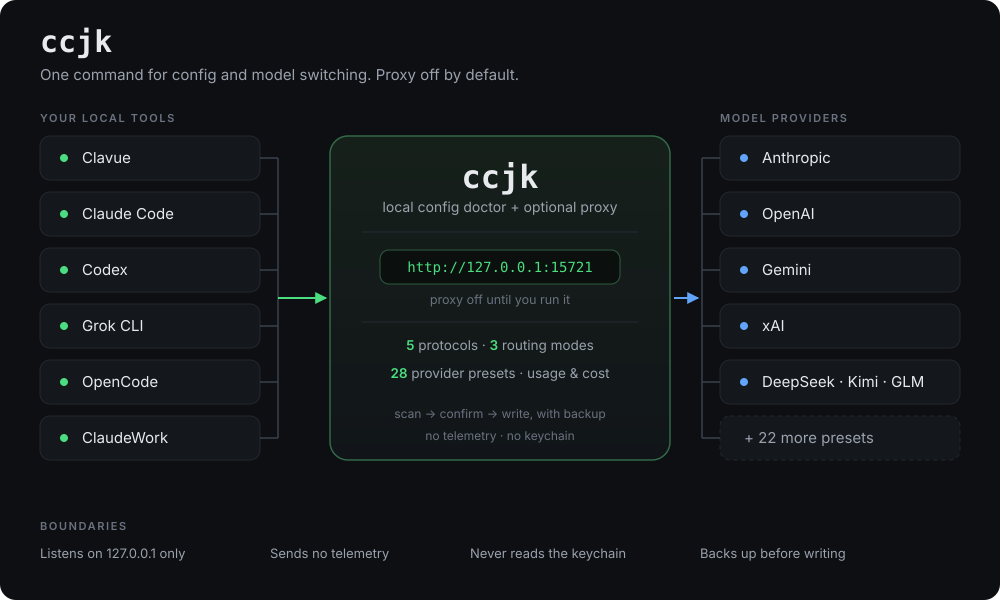

<div align="center">

# ccjk

### 给编码 agent 用的本地配置医生。

**Clavue · Claude Code · Codex · Grok · OpenCode · ClaudeWork**<br>
扫描本地配置，确认后写入 API、MCP、模型和工作流。<br>
遇到工具听不懂的接口，ccjk 在 `127.0.0.1` 开一个本机代理做翻译。

[](https://www.npmjs.com/package/ccjk)
[](./LICENSE)
[](https://nodejs.org)
[](https://github.com/miounet11/ccjk/stargazers)<br>


[English](./README.md) · **简体中文**

<br>



</div>

<br>

## 适合谁

每个 agent 把自己的模型存在自己的文件里，格式还各不相同——Claude Code 是 JSON，Codex 是 TOML，下一个又是别的。换一家服务商就要逐个手改，改错一次就是一个坏掉的会话。

ccjk 是替你做这件事的终端工具，而且每次写盘前先备份。适合你，如果：

- **你已经在用** Clavue、Claude Code、Codex 或 Grok，想少手改 JSON 和 TOML。
- **你想把几家模型**接到这些工具上，并且只接受本机转发。
- **你希望换模型和管配置是同一个命令**，而不是再养一个常驻应用。

它**不是** IDE，不是 orchestrator，也不是 agent runtime。它不替你写代码。代理只在你运行它的时候存在。

## 30 秒开始

需要 Node.js 20 或更新版本。

```sh
npm install -g ccjk
ccjk
ccjk ui
ccjk proxy use --tool claude-code --model deepseek/deepseek-chat
```

`ccjk` 打开医生 / 操作员菜单。`ccjk ui` 在代理没运行时把它拉起来，并打开本机界面，默认是 `http://127.0.0.1:15721/ui`。最后一行按「工具 + 服务商 / 模型」写入：这个工具听得懂该接口就直接连接，听不懂就经过本机。

升级：`npm install -g ccjk@latest`

## 它能做什么

**医生 —— 只读。** 扫描脏 MCP、坏 Skill、冗余 prompt 和配置风险。不写任何东西。

```sh
ccjk clean          # 交互式清理
ccjk clean -s       # 非交互，仅清理高置信度项
```

**操作员 —— 先备份，再写入。** API、MCP、模型、工作流、记忆。

```sh
ccjk init -T codex  # -T clavue | claude-code | codex | grok
```

**可选的本机代理。** 默认不开。只听 `127.0.0.1`，默认端口 `15721`。请求里的身份固定是 `ccjk-proxy`。

- **每个工具三种路由**：顺序、轮流、按用量。同一段对话在上游还健康时继续用同一家；连续失败会熔断，再换下一家。
- **协议互转。** Claude 系说 `anthropic-messages`；Codex、Grok、OpenCode 说 `openai-chat`、`openai-responses` 和 `xai`；也支持 Gemini。听懂不了的接口经过本机代理双向翻译。
- **思考过程会留下来。** OpenAI 的 `reasoning_content` 会变成 Claude 能读的 `thinking`，反向也一样。
- **密钥不进 `proxy.json`。** 服务商密钥放在 `proxy-secrets.json`（AES-256-GCM）。工具配置里写的是本机地址和本机令牌。
- **导入你已有的地址**，来自你自己的 Claude、Codex、Grok 配置。`127.0.0.1`、`localhost`、`::1` 会跳过。
- **配置档可以起中文名**：`ccjk proxy save --name 上班` / `ccjk proxy load --name 上班`。
- **第一次写入前留快照。** `ccjk proxy revert` 按快照还原。
- **用量与花费**：按每百万 token 估一个参考价，并给出缓存命中。这是估算，不是账单。

## 支持的工具

| 工具 | 配置根目录 | ccjk 能力 |
|---|---|---|
| **Clavue** | `~/.clavue/` | 医生 + 操作员：init / MCP / 模型 / 工作流 / 权限 / 清理 |
| **Claude Code** | `~/.claude/` | 同上 |
| **Codex** | `~/.codex/`（`CODEX_HOME`） | 同上 + 三端共用配置（见下） |
| **Grok CLI** | `~/.grok/` + `~/.ccjk/` profile | 医生（清理 skills）+ 轻量操作员（profile 启动） |
| **OpenCode** | `opencode` 配置 | 代理路由 |
| **ClaudeWork** | `~/.claudework/` | 代理路由 |

ccjk 自身配置只在 `~/.ccjk/`，**绝不混入**各工具目录。代理配置也在这里：`proxy.json` 记路由，`proxy-secrets.json` 记密钥。

### Codex：CLI + 桌面 App + IDE 扩展

OpenAI 官方设计下，三端**共用同一份** `config.toml`：

- 默认路径：`~/.codex/config.toml`
- 可用环境变量 `CODEX_HOME` 覆盖配置根
- `~/Library/Application Support/Codex`（macOS）等是 Electron 运行时缓存，**不是**配置目录

ccjk 写入配置后：**CLI / IDE 扩展**通常即时生效；**桌面 App** 若正在运行，需**完全退出后重新打开**。

医生中心会显示三端检测状态，并对第三方 provider + `features.goals` / `multi_agent` 给出配置风险提示。

### Codex 初始化预设

| 预设 | AGENTS | 工作流 | MCP |
|---|---|---|---|
| **干净** | 不写 | 不装 | 不装 |
| **优化** | 工程基线 | 默认工程流 | 仅 context7 |
| **自定义** | 用户自选 | 用户自选 | 用户自选 |

## 服务商

内置 28 个预设，也可以接任何 OpenAI 兼容端点：

Anthropic · OpenAI · xAI · Gemini · OpenRouter · DeepSeek · Kimi / Moonshot · 智谱 GLM · MiniMax · 阿里云百炼 · 火山方舟 · SiliconFlow · Groq · Together · Fireworks · Mistral · DeepInfra · Cerebras · SambaNova · NVIDIA NIM · Perplexity · 阶跃星辰 · 零一万物 · 百川 · 腾讯混元 · GitHub Models · Ollama · LM Studio

## 和 cc-switch、magpie 怎么选

三家都在解决「别再手改各家配置」，形态不同。下面按各自介绍页写的事实对照。

| | ccjk | [cc-switch](https://github.com/farion1231/cc-switch) | [magpie](https://github.com/yetone/magpie) |
|---|---|---|---|
| 形态 | 终端 CLI | 桌面应用 | 菜单栏 + 本地网关 |
| 主业 | 扫配置、备份后写入、还原 | 在一个应用里管服务商、MCP、Skills、Prompts | 把很多 agent 的模型接到一个网关 |
| 代理 | 可选，只听 `127.0.0.1` | 以改各客户端配置为主 | 网关就是产品，默认本机，也可以共享到局域网 |
| 密钥 | 你自己的密钥，不读钥匙串 | 在应用里填写和切换 | 可读钥匙串，也能发现订阅 |
| 路由 | 顺序、轮流、按用量，同一段对话粘住 | 切换当前供应商 | 还有 smart、pace |
| 遥测 | 没有 | 介绍页没有把遥测当作功能 | 介绍页写了每日遥测 |

已经在终端里管这几个工具时，ccjk 更直接：

- 配置和代理是同一个命令。换模型不用再装一个常驻应用。
- 代理不监听局域网，不读钥匙串，不冒充官方客户端，也不上报使用情况。
- 写进工具之前先留快照，可以还原。
- 中文界面。一行命令指定工具和「服务商 / 模型」。

他们覆盖得更宽的地方，ccjk 不做：桌面里同时管 MCP、技能和提示词，菜单栏，订阅和钥匙串，六十多个 agent，插件，smart / pace，局域网和 Docker。要这些，用他们。

## 医生和操作员

| 角色 | 做什么 | 怎么用 |
|---|---|---|
| **医生** | 只读扫描脏 MCP、坏 Skill、冗余 prompt、配置风险 | `ccjk clean`、菜单 **H** 医生中心 |
| **操作员** | 备份后写入 API / MCP / 模型 / 工作流 | `ccjk init`、菜单 **W** 快捷向导 |

启动交互菜单（推荐入口）：

```sh
ccjk
```

主菜单按 **操作员 / 医生 / 跨工具 / CCJK** 分区；按 **W** 进快捷向导，按 **H** 进医生中心。

## 多语言

ccjk 默认使用 **简体中文**，并支持英文和日文界面：

```sh
ccjk --lang zh-CN   # 简体中文（默认）
ccjk --lang en      # English
ccjk --lang ja      # 日本語
```

首次启动会先选择显示语言，再选择 Clavue / Claude Code / Codex / Grok CLI。进入菜单后建议按 **W** 走快捷向导；如果环境不确定，先按 **H** 做医生体检。

## 常见场景

| 场景 | 命令 / 操作 |
|---|---|
| 第一次配置某个工具 | `ccjk init -T codex`（或 `clavue` / `claude-code` / `grok`） |
| Codex 干净起步 / 日常优化 | 菜单 **W** → 完整初始化（预设：干净 / 优化 / 自定义） |
| 环境脏了想清理 | `ccjk clean` 或菜单 **H** → 智能清理 |
| 彻底重置 Codex 再初始化 | 菜单 **W** → 重置后初始化 |
| API 通不通 | `ccjk probe` |
| 切换 Codex API 提供商 | `ccjk config-switch` |
| 给某个工具指定模型 | `ccjk proxy use --tool codex --model deepseek/deepseek-chat` |
| 保存 / 换回一整套代理路由 | `ccjk proxy save --name 上班` / `ccjk proxy load --name 上班` |
| 还原被代理改过的配置 | `ccjk proxy revert` |
| Grok / Reasonix 状态与启动 | `ccjk grok` / `ccjk reasonix` |
| 检查工具版本更新 | `ccjk check-updates` |

## CLI 命令

| 命令 | 用途 |
|---|---|
| `ccjk` | 交互菜单（默认） |
| `ccjk init` | 完整初始化（API、MCP、模型、工作流、记忆） |
| `ccjk clean` | 环境清理：脏 MCP、坏 Skills、冗余 prompts |
| `ccjk clean --purge-all` | 全部清理（删前备份 Codex 配置） |
| `ccjk clean -s` | 非交互，仅清理高置信度项 |
| `ccjk probe` | HTTP 探活当前 API |
| `ccjk bench` | 轻量延迟基准 |
| `ccjk config-switch` | 切换 Codex provider / Claude 配置 |
| `ccjk update` | 仅更新工作流与记忆文档 |
| `ccjk check-updates` | 检查并更新 Claude Code / Codex / CCR |
| `ccjk grok [profile]` | Grok CLI 状态与 profile 启动 |
| `ccjk reasonix [profile]` | Reasonix 伴侣：状态与启动 |
| `ccjk uninstall` | 卸载 CCJK 管理的配置 |
| `ccjk ccr` | Claude Code Router 配置 |
| `ccjk ccu` | Claude Code 用量分析 |
| `ccjk proxy` | 本机代理：`serve` / `start` / `stop` / `status` / `apply` / `revert` / `switch` / `use` / `save` / `load` |
| `ccjk ui` | 打开本机代理界面。代理没在跑时会先启动。 |

工具别名：`-T cv`（Clavue）、`-T cc`（Claude Code）、`-T cx`（Codex）、`-T gk`（Grok）。

## 设计原则

- **配置工具就是配置工具** —— 不做 brain、orchestrator。代理只在你运行 `ccjk proxy` 或 `ccjk ui` 时出现
- **不主动写代码** —— 不在运行时偷偷注入 hook 或命令
- **备份先行** —— 任何写盘前产生备份；代理写入另外留第一次快照，可用 `ccjk proxy revert` 还原
- **可重复** —— `init -s`、`clean -s`、`clean --purge-all`、`proxy use` 等支持脚本化
- **本机为界** —— 代理只听 `127.0.0.1`，不读钥匙串，不发送遥测

## 文档

- [QUICKSTART.md](./docs/QUICKSTART.md) —— 可直接复制的上手指引
- [PRODUCT.md](./PRODUCT.md) —— 产品边界与行为
- [ARCHITECTURE.md](./ARCHITECTURE.md) —— 架构不变量
- [RELEASE-NOTES.md](./docs/RELEASE-NOTES.md) —— 版本历史
- [CHANGELOG.md](./CHANGELOG.md) —— 变更记录
- [宣传页](./site/index.html) —— 零依赖静态介绍页

## 开发

```sh
pnpm install
pnpm typecheck
pnpm test
pnpm lint
pnpm build

# 冒烟：进入 Codex 菜单
echo '' | node dist/cli.mjs -T codex
```

## 许可

[MIT](./LICENSE)
